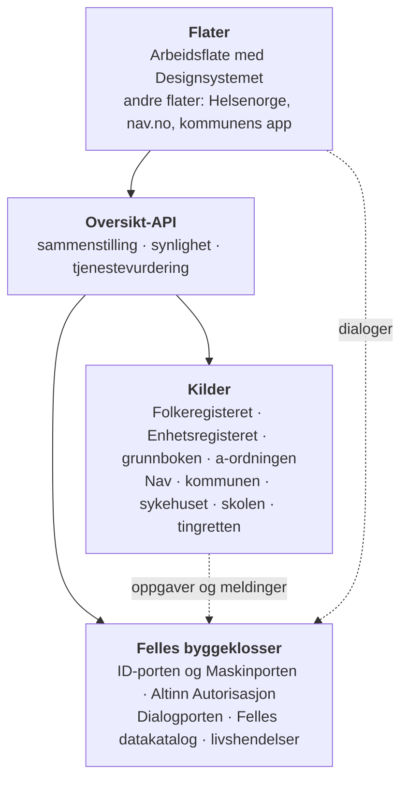
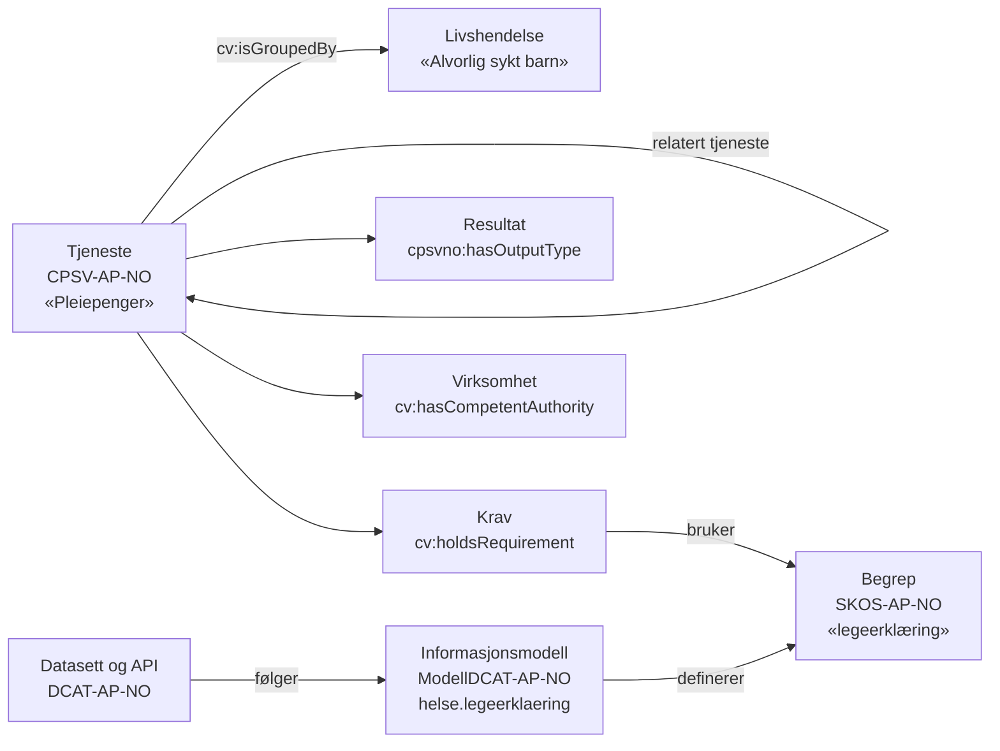
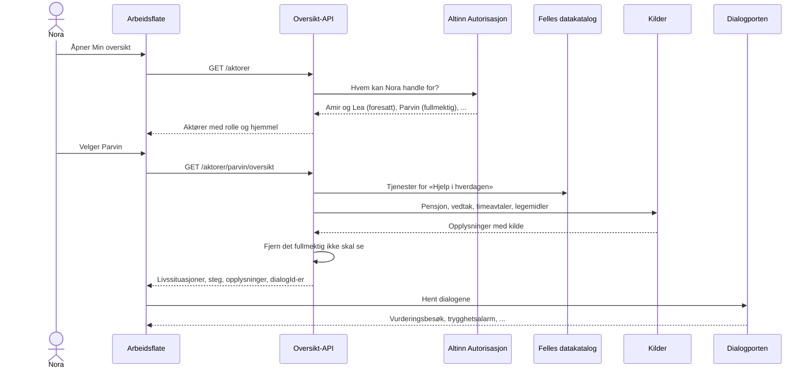
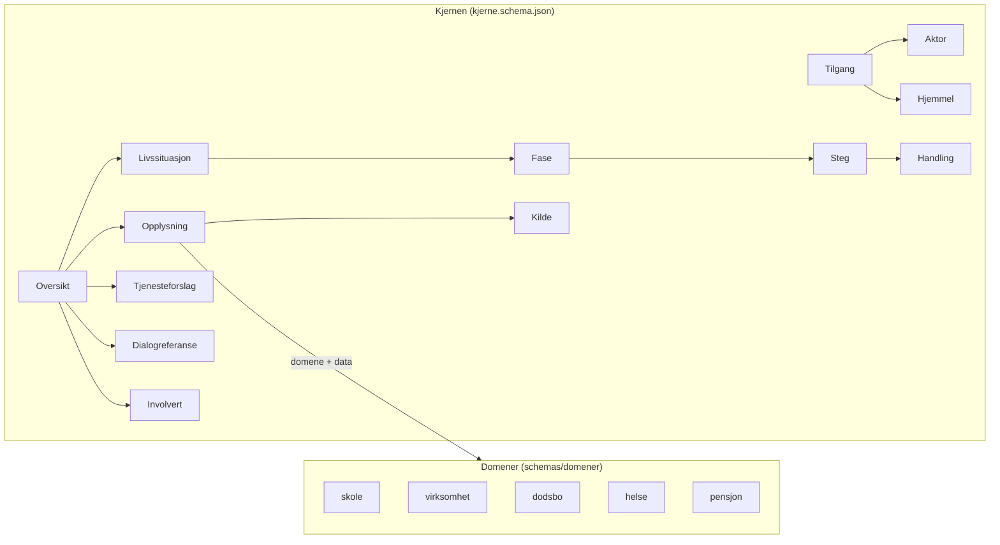
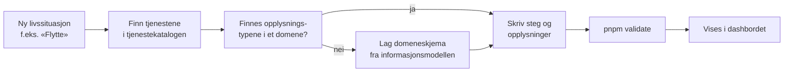

# Arkitektur og byggeklosser

Min oversikt er ikke en ny portal. Det er en sammenstilling av byggeklosser som stort sett finnes allerede: registre
som vet hvem du kan handle for, kataloger som beskriver tjenester og opplysninger, fagsystemer som vet status, og
Dialogporten som bærer oppgaver og meldinger. Det nye er et API som setter dem sammen rundt en livssituasjon, og
et dashbord som viser det.

Denne siden forklarer lagene, byggeklossene og standardene, hvordan løsningen utvides, og hva som mangler for at
den skal virke i virkeligheten. Se [familien](familien.md) for hvem demoen handler om, og [API-guiden](guide.md) for
detaljene i kontrakten.

## Lagene

Pilene viser hvem som spør hvem. Arbeidsflate henter også dialogene direkte fra Dialogporten, og fagsystemene
legger oppgaver og meldinger dit.

1. **Kilder** eier opplysningene og statusen. De endres ikke for å passe oversikten, men eksponerer det de har
   gjennom API-er som er beskrevet i Felles datakatalog.
2. **Felles byggeklosser** sier hvem du er, hvem du kan handle for, hvilke tjenester som finnes og hva
   opplysningene betyr. De er nasjonale og brukes av alle.
3. **Oversikt-API** setter dette sammen for én aktør og én rolle, og fjerner det rollen ikke skal se, før svaret
   forlater tjenesten.
4. **Flater** viser svaret. Arbeidsflate er én, men kontrakten er laget for at andre også kan bruke den.

## Byggeklossene

| Byggekloss | Hva den gjør i oversikten | Standard eller spesifikasjon | I demoen |
|---|---|---|---|
| ID-porten | Logger inn personen | OpenID Connect | Mock (`playwrightId`) |
| Maskinporten | Gir Oversikt-API tilgang til kildene | OAuth 2.0 | Ikke med |
| Altinn Autorisasjon | Hvem du kan handle for, og med hvilken rolle | Tilgangspakker, roller, fullmakter | `tilganger.json` |
| Folkeregisteret | Foreldreansvar, sivilstand, dødsfall, adresse | Folkeregisterets API | Opplysninger i dataene |
| Enhetsregisteret | Roller i virksomheter | Enhetsregisterets API | `virksomhet.roller` |
| Helsenorge fullmakter | Fullmakt til timeavtaler, ikke journal | Helsenorges fullmaktsmodell | Merknad hos Parvin |
| Samtykke | Deling som ikke har hjemmel, f.eks. til skolen | Altinn samtykke | `krevesSamtykke` |
| Dialogporten | Oppgaver, meldinger, vedtak og frister | Dialogportens API | `dialoger.json` |
| Tjenestekatalogen | Hvilke tjenester som finnes, og hvem som har ansvar | CPSV-AP-NO | `tjenester.json` |
| Begrepskatalogen | Hva «pleiepenger», «avlastning» og «fullmektig» betyr | SKOS-AP-NO-Begrep | Ikke med |
| Informasjonsmodellkatalogen | Hva en opplysning inneholder | ModellDCAT-AP-NO | `schemas/domener` |
| Datasettkatalogen og API-katalogen | Hvor opplysningene finnes og hvordan de hentes | DCAT-AP-NO | `Kilde` på hver opplysning |
| Livshendelser | Felles navn på livssituasjonene | data.norge.no/vocabulary/life-event-type | `Livssituasjon.type` |
| Oversikt-API | Sammenstilling, synlighet og vurdering | OpenAPI 3.1 og JSON Schema 2020-12 | `openapi.yaml`, MSW |
| Arbeidsflate | Flaten der oversikten vises | React, Altinn-komponenter | Denne forken |
| Designsystemet | Komponenter og uttrykk | designsystemet.no | Via Altinn-komponentene |

### Felles datakatalog i mer detalj

Felles datakatalog er det som gjør løsningen generell. Uten den må hver livssituasjon modelleres for hånd. Med den
kan oversikten finne tjenestene, forstå opplysningene og vite hvor de hentes.

| Katalog | Spørsmål den svarer på | Brukes til |
|---|---|---|
| Tjenester (CPSV-AP-NO) | Hvilke tjenester hører til livssituasjonen, hvem har rett, hva får du, hva henger sammen | Steg, tjenesteforslag, tjenestesiden |
| Begreper (SKOS-AP-NO) | Hva betyr ordene | Forklaringer og felles språk mellom etatene |
| Informasjonsmodeller (ModellDCAT-AP-NO) | Hva inneholder en opplysning | Domeneskjemaene i `schemas/domener` |
| Datasett og API (DCAT-AP-NO) | Hvem har opplysningen og hvordan hentes den | `Kilde` og kildestatus |
| Livshendelser (vokabular) | Hva heter situasjonen | `Livssituasjon.type` |

**Status i dag.** Tjenestekatalogen har rundt 1 460 offentlige tjenester, men ingen av dem er knyttet til en
livshendelse. Krav, resultater og relasjoner mellom tjenester er sjelden fylt ut. Tjenestesiden i demoen viser dette
felt for felt i `katalogdekning`:

| Det tjenestesiden viser | Felt i CPSV-AP-NO | Finnes i katalogen |
|---|---|---|
| Navn og beskrivelse | `dct:title`, `dct:description` | ja |
| Ansvarlig virksomhet | `cv:hasCompetentAuthority` | ja |
| Regelverk | `cpsv:follows`, `cv:hasLegalResource` | sjelden |
| Hvem har rett | `cv:holdsRequirement` | nei |
| Hva du får | `cpsvno:hasOutputType` | nei |
| Henger sammen med | `cv:relatedService`, `dct:requires` | nei |
| Livssituasjonen | `cv:isGroupedBy` → `cv:LifeEvent` | nei |
| Kontaktinformasjon | `cv:contactPoint` | nei |
| Dette vet vi allerede | fra kildene, med hjemmel | utenfor katalogen |
| Status for deg | fra saksbehandlingen | utenfor katalogen |

De to siste radene hører ikke hjemme i en katalog. De kommer fra kildene, og er grunnen til at Oversikt-API trengs i
tillegg til katalogen.

## Slik flyter et kall

Oversikt-API henter ikke dialogene selv. Den peker på dem med `dialogId`, og Arbeidsflate henter dem fra
Dialogporten som før. Da blir det ikke to steder å lese den samme meldingen.

## Kjernen og domenene

Kontrakten har en kjerne som ikke vet noe om skole, helse eller dødsbo, og domener med opplysningstypene.

| Kjernetype | Svarer til | Kommer fra |
|---|---|---|
| `Aktor` | Party i Altinn, person eller enhet | Folkeregisteret, Enhetsregisteret |
| `Tilgang`, `Rolle`, `Hjemmel` | Rolle, tilgangspakke eller fullmakt | Altinn Autorisasjon, Helsenorge |
| `Livssituasjon` | `cv:LifeEvent` | Livshendelsesvokabularet og tjenestekatalogen |
| `Steg` | En tjeneste i livssituasjonen, med status for aktøren | Tjenestekatalogen og fagsystemet |
| `Tjeneste` | `cpsv:PublicService` | Tjenestekatalogen |
| `Tjenestevurdering` | `cv:holdsRequirement` vurdert mot aktøren | Fagsystemet eller regler som kode |
| `Kjentopplysning` | Opplysning som gjenbrukes, «once only» | Kildene, med hjemmel |
| `Opplysning` | Et utsnitt av et datasett | Kilden, beskrevet med DCAT-AP-NO |
| `Opplysning.domene` | En klasse i en informasjonsmodell | ModellDCAT-AP-NO |
| `Kilde` | `dct:publisher` på datasettet | Datasettkatalogen |
| `Dialogreferanse` | En dialog | Dialogporten |
| `Sammenheng` | Relasjon mellom aktører og saker | Utledes av Oversikt-API |

## Slik utvides løsningen

Det meste skjer i data, ikke i kode. Bestemoren Parvin er et eksempel: hun ble lagt til med én ny rolle, ett nytt
domene og to nye opplysningstyper i helse. Dashbordet ble ikke endret.

| Vil du legge til | Endre | Kode i dashbordet |
|---|---|---|
| En ny aktør | En fil i `data/aktorer` og en tilgang | Nei |
| En ny livssituasjon | Faser og steg i aktørens data | Nei |
| En ny tjeneste | En oppføring i tjenestekatalogen | Nei |
| En ny opplysningstype | En `$defs`-oppføring i et domeneskjema | Nei |
| Et nytt domene | En ny fil i `schemas/domener` | Nei |
| En ny rolle | Én verdi i `Rolle` og én tekst i oversettelsene | Nei |
| En ny kilde | En adapter i Oversikt-API som gir `Opplysning` med `Kilde` | Nei |
| En ny flate | Les det samme API-et | Ny flate |

`pnpm --filter oversikt-api validate` sjekker at kontrakten, dataene, domenetypene, kryssreferansene og alle
API-svarene stemmer. Redigeringsappen og API-referansen finner nye domener selv.

## Personvern og tilgang

- **Hjemmel først.** Hver tilgang har en hjemmel med kilde. Oversikten viser ikke noe rollen ikke gir rett til.
- **Filtrering i tjenesten.** `synligFor` og `rolletekster` brukes før svaret sendes, så klienten aldri får det den
  ikke skal vise.
- **Dataminimering.** Leas diagnose og Parvins legemidler er ikke med. Tjenestene trenger bare å vite at Lea følges
  av spesialisthelsetjenesten, og at Parvin har multidose.
- **Fullmakt er ikke innsyn i alt.** Nora ser Parvins timeavtaler, men ikke journalen, og siden sier det.
- **Samtykke når hjemmel mangler.** At Amir har det tungt hjemme, deles bare med skolen hvis Nora sier ja.
- **Sletting.** `lagresTil` viser når opplysningene slettes, slik Digitalt dødsbo sletter etter 12 måneder.

## Mock og virkelighet

| Del | I demoen | I virkeligheten |
|---|---|---|
| Innlogging | `playwrightId` i adressen | ID-porten |
| Tilganger | `tilganger.json` | Altinn Autorisasjon, Folkeregisteret, Enhetsregisteret, Helsenorge |
| Oversikt-API | Kjører i nettleseren (MSW) | Egen tjeneste med Maskinporten mot kildene |
| Opplysninger | JSON-filer | API-er hos kildene |
| Tjenester | `tjenester.json`, skrevet for hånd | Tjenestekatalogen i Felles datakatalog |
| Dialoger | Mockede dialoger i Arbeidsflate | Dialogporten |
| Tjenestevurdering | Skrevet for hånd | Fagsystemet eller regler som kode |
| Sammenhenger | Skrevet for hånd | Utledet av relasjoner i registrene |

## Hull som må tettes

1. **Livshendelser i tjenestekatalogen.** Ingen tjenester er knyttet til en livshendelse i dag, og krav,
   resultater og relasjoner mangler. Uten dem kan ikke stegene og forslagene lages automatisk.
2. **Informasjonsmodeller for opplysningene.** Domeneskjemaene her er laget for demoen. De bør komme fra
   informasjonsmodeller som kildene publiserer, med begreper fra begrepskatalogen.
3. **Status på tvers.** Hver etat har sin egen saksstatus. Oversikten trenger en felles, enkel statusliste, og
   Dialogporten er det nærmeste vi har.
4. **Fullmakter på ett sted.** Fullmakt i Altinn, på Helsenorge og hos Nav er forskjellige ordninger. Nora må i dag
   få fullmakt flere steder for å hjelpe Parvin.
5. **Vurdering av rettigheter.** «Hva har jeg rett til» krever regler som kan kjøres. Det finnes for noen ytelser,
   men ikke som en felles tjeneste.
6. **Kommunene.** Mye av hjelpen kommer fra kommunen, som har mange ulike fagsystemer. De må kunne levere dialoger og
   status på en felles måte.
7. **Sammenhenger.** Hvilke situasjoner som påvirker hverandre, er i dag kunnskap i hodene til saksbehandlere. Noe kan
   utledes av registrene, resten må modelleres.
