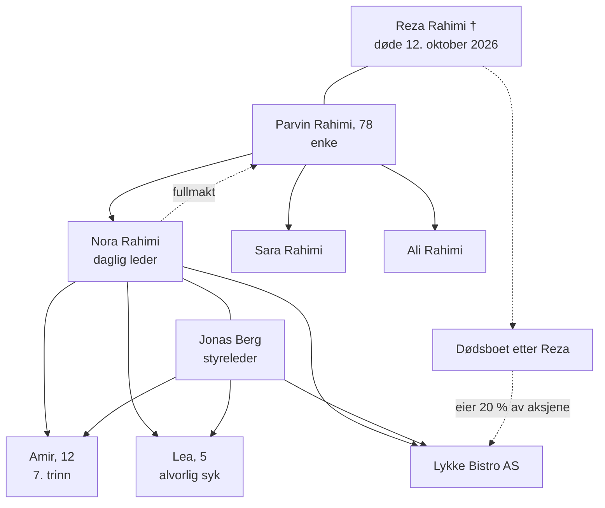

# Familien Rahimi Berg

Demoen er bygd rundt én familie. Alle personer, virksomheter og opplysninger er oppdiktet, men situasjonene, reglene
og tjenestene er virkelige. Familien er valgt fordi én person, Nora, står i fem livssituasjoner på én gang, og de
påvirker hverandre. Det er da en samlet oversikt gjør mest nytte.

Se også [arkitekturen](arkitektur.md) og [API-guiden](guide.md).

## Hvem Nora handler for

| Aktør | Noras rolle | Hjemmel | Livssituasjon |
|---|---|---|---|
| Nora selv | `selv` | Innlogget med ID-porten | Skatt, helse og arbeid |
| Amir, 12 | `foresatt` | Foreldreansvar (Folkeregisteret) | Barn og skole |
| Lea, 5 | `foresatt` | Foreldreansvar (Folkeregisteret) | Alvorlig sykt barn |
| Lykke Bistro AS | `daglig-leder` | Enhetsregisteret | Starte og drive bedrift |
| Parvin, 78 | `fullmektig` | Fullmakt i Altinn og på Helsenorge | Hjelp i hverdagen og Etter dødsfall |
| Dødsboet etter Reza | `arving` | Formuesfullmakt fra tingretten | Dødsfall og arv |

Rollene kommer fra registre som finnes i dag. Oversikten finner ikke på tilganger selv, den viser bare det rollen
gir rett til å se.

## Slik henger situasjonene sammen

| Sammenheng | Hva det betyr for Nora |
|---|---|
| Lea → Lykke Bistro | Nora er ansatt i eget AS, så restauranten må sende inntektsmelding før Nav kan behandle pleiepengene. |
| Reza → Lykke Bistro | Reza var stedfortreder for skjenkebevillingen. Bevillingen mangler nå stedfortreder. |
| Dødsboet → Lykke Bistro | Dødsboet eier 20 % av aksjene, som må skiftes og meldes. |
| Lea → Amir | Amir er søsken til et alvorlig sykt barn og har mistet bestefaren. Skolen kan følge ham opp hvis Nora sier ja. |
| Parvin → Dødsboet | Parvin bor i boligen som er en del av dødsboet og kan kreve å overta den. |
| Parvin → Nora | Nora er pårørende for to. Kommunen kan vurdere pårørendestøtte samlet. |

Hver av disse ville i dag vært en egen sak hos en egen etat. Ingen av etatene ser hele bildet, så det er Nora
som må oppdage dem.

---

## Nora Rahimi, mor og daglig leder

**Situasjon.** Nora er 44 år, gift med Jonas og mor til Amir og Lea. Hun driver Lykke Bistro AS sammen med Jonas og
er ansatt der. I oktober døde faren hennes, og i høst ble Lea alvorlig syk. Moren hennes, Parvin, klarer seg dårligere
alene og har gitt Nora fullmakt.

**Hva som er vanskelig i dag.**

- Hun må logge inn hos Nav, kommunen, Helsenorge, Altinn, skolen, tingretten og banken for å se hva som haster.
- Hun vet ikke hva hun har rett til, og finner det ut tilfeldig eller for sent.
- Ingen sier fra om at en sak hos én etat stopper en sak hos en annen, som inntektsmeldingen for pleiepengene.
- Hun gir de samme opplysningene på nytt i hver søknad.

**Hva oversikten gir henne.**

- Én side med alle hun handler for, og hvor mange oppgaver som venter hos hver.
- Sammenhengene på tvers, med hva hun bør gjøre først.
- «Siste meldinger» fra alle dialogene i innboksen, uansett hvem de gjelder.
- Opplysninger med kilde, så hun vet hvem hun skal kontakte når noe er feil.

[Se Noras oversikt i demoen](https://finnuro.github.io/arbeidsflate/oversikt?mock=true&playwrightId=rahimi-berg)

## Jonas Berg, far og styreleder

**Situasjon.** Jonas er far til Amir og Lea og styreleder i Lykke Bistro AS. Han deler omsorgen for Lea med Nora og
søker pleiepenger selv.

**Hva oversikten gir ham.** Han har foreldreansvar og ser derfor den samme oversikten for barna som Nora. For
restauranten ser han det styrelederrollen gir, ikke alt daglig leder ser. Han har ikke tilgang til Parvin eller
dødsboet, fordi han verken er arving eller har fullmakt.

Jonas har ingen egen innlogging i demoen. Han er med for å vise at to foresatte ser det samme.

## Amir Rahimi, 12 år

**Situasjon.** Amir går i 7. trinn ved Lykke barneskole og skal begynne på ungdomsskolen til høsten. Lillesøsteren er
alvorlig syk og bestefaren er død. Hjemme går mye av oppmerksomheten til Lea.

**Hva han trenger.**

- Å se sine egne oppgaver på skolen med enkle ord: fagtekst, utviklingssamtale og valg av fremmedspråk.
- Å kunne snakke med helsesykepleieren uten at foreldrene får vite det.
- At skolen vet at han har det tungt, hvis foreldrene sier ja til å dele det.

**Hva oversikten gir ham.** Amir ser bare seg selv. Tekstene er skrevet til ham («Du har lest mer og raskere siden
5. trinn»), og han ser samtalen med helsesykepleieren, som foreldrene ikke ser. Foreldrene ser til gjengjeld samtykker
og tilrettelegging, som han ikke ser. Det er samme data, filtrert med `synligFor` og tilpasset med `rolletekster`.

[Se Amirs oversikt i demoen](https://finnuro.github.io/arbeidsflate/oversikt?mock=true&playwrightId=rahimi-berg-amir)

## Lea Rahimi, 5 år

**Situasjon.** Lea går i Lykke barnehage og følges av barneavdelingen ved Lykke sykehus over lang tid. Diagnosen står
ikke i dataene. Tjenestene trenger bare å vite at hun følges av spesialisthelsetjenesten.

**Hva foreldrene trenger.** Foreldre til barn med sammensatte behov bruker i snitt 19 timer i uka (median 10) på å
lete etter informasjon, søke, klage og koordinere tjenester, ifølge Helsedirektoratets nullpunktsmåling fra 2021.
Det er tid som kommer i tillegg til selve omsorgen. Det de etterspør, er:

- Én oversikt over saker hos Nav, kommunen, sykehuset og barnehagen, med frister.
- Å slippe å fortelle historien på nytt og legge ved den samme legeerklæringen i hver søknad.
- Ett fast kontaktpunkt.
- Å se om det som er vedtatt faktisk blir levert.
- Å få vite hva de har rett til, i stedet for å lete.

**Hva oversikten gir.**

- Barnekoordinatoren, kontaktlegen og barnehagen øverst, med kontaktmuligheter.
- Pleiepenger, omsorgsdager, opplæringspenger, hjelpestønad og grunnstønad som steg, med status fra Nav.
- Én legeerklæring som er gjenbrukt i flere søknader.
- «6 av 12 timer avlastning levert i november».
- Avslaget på grunnstønad med klagefrist og hjelp til å klage.
- Pasientreiser som ikke er søkt refusjon for, før fristen på seks måneder går ut.
- Forslag som opplæringspenger, parkeringstillatelse og søskentilbud.

[Se Leas oversikt i demoen](https://finnuro.github.io/arbeidsflate/oversikt/aktor/urn%3Aaltinn%3Aperson%3Aidentifier-no%3Alea-rahimi?mock=true&playwrightId=rahimi-berg)

## Parvin Rahimi, 78 år

**Situasjon.** Parvin var gift med Reza i 54 år og bor alene i huset deres i Lykke siden han døde i oktober. Det var
Reza som tok seg av papirene og kjørte bil. Nå har hun sluttet å kjøre, glemmer legemidlene innimellom og har falt én
gang på badet. Hun vil bo hjemme så lenge som mulig.

Hun har gitt Nora fullmakt overfor Nav, Skatteetaten og kommunen, og til timeavtalene sine på Helsenorge. Hun er
fortsatt den som bestemmer.

**Hva som er vanskelig i dag.**

- Hjelpen kommer fra mange steder: kommunen (hjemmesykepleie, trygghetsalarm, dagsenter, middag), fylkeskommunen
  (TT-kort), Nav (hjelpemidler og pensjon), fastlegen og apoteket (multidose), Husbanken (bostøtte).
- Nora vet ikke hva som finnes, og må få fastlegen til å skrive den samme erklæringen flere ganger.
- En vanlig fullmakt slutter å gjelde hvis Parvin ikke lenger kan gi den selv. Få vet at en fremtidsfullmakt må
  ordnes mens det fortsatt er mulig.
- Arv og skifte etter Reza berører Parvin direkte, fordi hun bor i boligen som er i dødsboet.

**Hva oversikten gir Nora.**

- To livssituasjoner for Parvin: «Hjelp i hverdagen» (hjemme, ute, framover) og «Etter at Reza døde».
- Vurderingsbesøket fra kommunen, søknaden om trygghetsalarm og vedtaket om hjemmesykepleie, med det kommunen
  allerede vet.
- At pensjonen er beregnet på nytt med gjenlevenderett, uten at Parvin måtte søke.
- Neste time hos fastlegen, men ikke journalen. Fullmakten gir ikke innsyn i den, og siden sier det.
- At legemidlene er i multidose og når listen sist ble endret, men ikke hvilke legemidler hun bruker.
- Forslag om fremtidsfullmakt, middag levert hjem, sorggruppe og bostøtte.
- En sammenheng til Nora selv: hun er nå pårørende for to, og kan få pårørendestøtte.

**Det oversikten ikke gjør.** Den tar ikke beslutninger for Parvin. Nora ser det fullmakten gir rett til, og alt
Parvin kan se selv, kan hun fortsatt se selv.

[Se Parvins oversikt i demoen](https://finnuro.github.io/arbeidsflate/oversikt/aktor/urn%3Aaltinn%3Aperson%3Aidentifier-no%3Aparvin-rahimi?mock=true&playwrightId=rahimi-berg)

## Reza Rahimi og dødsboet

**Situasjon.** Reza døde 12. oktober 2026, 80 år gammel. Han eide boligen der han og Parvin bodde, 20 % av aksjene
i Lykke Bistro AS og en bil, og var stedfortreder for restaurantens skjenkebevilling. Han hadde ikke testament.

Arvingene er Parvin og de tre barna, Nora, Sara og Ali. De har valgt privat skifte. Nora, Sara og Parvin (gjennom
Nora) har signert. Ali har ikke signert ennå.

**Hva arvingene trenger.** Etter et dødsfall må pårørende ofte finne ut selv hva avdøde eide og skyldte, hvilke
avtaler som må sies opp, og hva som må meldes hvor. Mye av dette vet det offentlige allerede.

**Hva oversikten gir.**

- At dødsfallet er meldt og at Nav, Skatteetaten og tingretten er varslet.
- Konti, gjeld, eiendom, kjøretøy, pensjon og forsikring, skatt, aksjer og testament, hver med kilde.
- Faste trekk på kontoene som kan sies opp.
- Arvingene med signeringsstatus: «3 av 4 har signert».
- At boligen er der Parvin bor, og at aksjene i restauranten må skiftes.
- At opplysningene slettes 12 måneder etter dødsfallet, slik Digitalt dødsbo gjør.

[Se dødsboet i demoen](https://finnuro.github.io/arbeidsflate/oversikt/aktor/urn%3Aaltinn%3Aorganization%3Aidentifier-no%3Adodsbo-reza-rahimi?mock=true&playwrightId=rahimi-berg)

## Lykke Bistro AS

**Situasjon.** En restaurant i Lykke sentrum med seks ansatte. Nora er daglig leder, Jonas er styreleder, og
regnskapsføreren har tilgang til skatt og mva. Aksjonærene er Nora, Jonas og Reza, nå dødsboet.

**Hva virksomheten trenger.** Restauranten har hatt det travelt med vanlige frister (a-melding, mva-melding,
omsetningsoppgave for alkohol), og nå kommer endringer som følger av det som skjer i familien.

**Hva oversikten gir.**

- Inntektsmeldingen for Noras pleiepenger som en oppgave, med begrunnelse.
- At skjenkebevillingen mangler stedfortreder etter Rezas død, og hvordan det meldes.
- At aksjeeierne må meldes på nytt når dødsboet er skiftet.
- Hvem som ser oversikten, og hva regnskapsføreren ser.

[Se restauranten i demoen](https://finnuro.github.io/arbeidsflate/oversikt/aktor/urn%3Aaltinn%3Aorganization%3Aidentifier-no%3Alykke-bistro?mock=true&playwrightId=rahimi-berg)

## Sara og Ali Rahimi

Noras søsken er arvinger, men har ingen innlogging i demoen. Sara har signert for privat skifte, Ali har ikke. I
dødsboets oversikt står de som involverte med signeringsstatus. Hos Parvin står de som familie, og
pårørendesammenhengen foreslår at én av dem også får fullmakt, så de kan dele på oppgavene.
