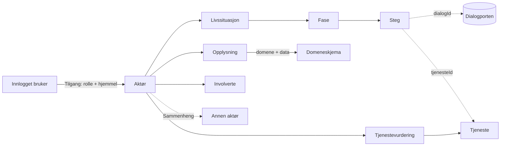

# Oversikt-API – guide

Oversikt-API er ett felles API for «Min oversikt»-dashbordene: én side som viser en person det som gjelder dem
og dem de handler for, på tvers av livssituasjoner som skole, egen virksomhet og et dødsbo. Denne guiden forklarer
begrepene, hvordan et dashbord bruker API-et, og hvordan modellen utvides med nye domener.

- **Referanse med alle felt og eksempelsvar:** https://finnuro.github.io/arbeidsflate/api/
- **Kontrakten:** [`openapi.yaml`](../openapi.yaml) og skjemaene i [`schemas/`](../schemas)
- **Demo:** https://finnuro.github.io/arbeidsflate/ (Nora) og
  https://finnuro.github.io/arbeidsflate/oversikt?mock=true&playwrightId=rahimi-berg-amir (Amir)

Status: konsept. All data er oppdiktet (familien Rahimi Berg i Lykke kommune).

## Grunnidé

Et dashbord skal kunne vise skolegang, en restaurant og et dødsbo uten å kjenne noen av dem. Derfor er API-et delt
i to lag:

1. **Kjernen** er lik for alle livssituasjoner: hvem du ser oversikten for, hvilke steg som gjenstår, hvilke
   opplysninger det offentlige har, hvilke tjenester som er aktuelle og hvordan sakene henger sammen. Kjernen har
   nok felt til at dashbordet kan tegne alt.
2. **Domenene** beskriver detaljene. En opplysning om fravær har kjernefelt som `tittel` og `hovedverdi`
   («3 dager og 4 timer»), og i tillegg `domene: "skole.fravaer"` og `data` med dager, timer og registreringer.
   Skjemaet for `data` ligger i [`schemas/domener/skole.schema.json`](../schemas/domener/skole.schema.json).

Dashbordet bruker bare kjernen. En detaljvisning eller en annen tjeneste kan bruke `data` når den kjenner domenet.

Oppgaver og meldinger lages ikke på nytt her. De er dialoger i Dialogporten, og Oversikt-API peker bare til dem.

## Begreper



| Begrep | Hva det er | Eksempel |
|---|---|---|
| **Aktør** | Den oversikten gjelder: en person, en virksomhet eller et dødsbo. Id-en er party-URN som i Altinn. | `urn:altinn:person:identifier-no:amir-rahimi` |
| **Tilgang** | At den innloggede kan se aktøren, med **rolle** og **hjemmel** (hvorfor, og hvem som sier det). | Nora er `foresatt` for Amir. Hjemmel: «Du har foreldreansvar», kilde Folkeregisteret. |
| **Rolle** | Den innloggedes forhold til aktøren. Styrer hva som vises. | `selv`, `foresatt`, `daglig-leder`, `styreleder`, `regnskapsforer`, `arving` |
| **Livssituasjon** | En livshendelse aktøren er i, delt i **faser** med **steg**. | «Barn og skole» med fasene Skolehverdag og Overgang til ungdomsskolen |
| **Steg** | Noe som skal skje, med status, frist og ansvarlig. Kan peke til en dialog, en tjeneste eller en handling, og vise hvilke opplysninger som gjenbrukes. | «Skoleplass på Lykke ungdomsskole», status `ordnet-automatisk`, bruker adresse fra Folkeregisteret |
| **Opplysning** | Noe det offentlige vet om aktøren, alltid med **kilde** og hentet-tidspunkt. | Fravær, eierandeler, bankkontoer |
| **Tjeneste** | Utdrag av en offentlig tjeneste etter CPSV-AP-NO, med `katalogdekning` som viser hvilke felt som finnes i Felles datakatalog i dag. | Skoleskyss |
| **Tjenestevurdering** | Tjenesten sett for én aktør: om den gjelder, hva som allerede er kjent og hva som må gjøres. | «Du trenger ikke søke», gangavstand 3,6 km |
| **Sammenheng** | En kobling mellom to aktører som brukeren bør vite om. | Bestefaren var stedfortreder for skjenkebevillingen til restauranten |
| **Involvert** | Andre parter i saken. | Medarvinger med signeringsstatus, hvem som ser virksomhetens oversikt |
| **Kildestatus** | En kilde som ikke svarte, så brukeren vet at noe mangler. | «Skolens læringsplattform svarer ikke» |

### Status

Steg har én av disse statusene. Er steget knyttet til en dialog, bruker dashbordet dialogens status i Dialogporten
i stedet, så statusen bare finnes ett sted.

`ordnet-automatisk`, `krever-handling`, `til-signering`, `til-behandling`, `under-arbeid`, `utkast`, `venter`,
`utfort`, `ikke-startet`, `ikke-aktuelt`, `senere`

### Handlinger

Knapper og lenker beskrives som en `Handling` med `type` og `mal`:

| type | mal er | Dashbordet gjør |
|---|---|---|
| `dialog` | dialog-id i Dialogporten | åpner dialogen i innboksen |
| `tjeneste` | tjeneste-id | åpner tjenestesiden, med vurderingen for aktøren |
| `aktor` | party-URN | åpner aktørens oversikt |
| `lenke` | URL | åpner lenken (`#` er en plassholder i konseptet) |

## Slik bruker et dashbord API-et

1. **`GET /aktorer`** gir hvem den innloggede kan se oversikten for. Den innloggede selv kommer først. Hver tilgang
   har rolle, hjemmel og antall steg som krever handling, nok til forsidekortene.
2. **`GET /sammenhenger`** gir koblinger på tvers av aktørene, for den samlede oversikten.
3. **`GET /aktorer/{aktorId}/oversikt`** gir alt dashbordet for én aktør trenger, allerede filtrert etter rollen.
4. Dialogene hentes fra **Dialogporten** med dialog-id-ene i `dialoger` og på stegene.
5. **`GET /aktorer/{aktorId}/tjenester/{tjenesteId}`** gir den personlige delen av en tjenesteside. Svarer den 404,
   er tjenesten ikke vurdert for aktøren, og siden viser bare katalogteksten fra **`GET /tjenester/{tjenesteId}`**.
6. **`GET /domener`** gir alle opplysningstypene og hvor skjemaet til `data` ligger.

`aktorId` er URL-kodet i stien, for eksempel `/aktorer/urn%3Aaltinn%3Aperson%3Aidentifier-no%3Aamir-rahimi/oversikt`.

### Eksempel: en opplysning

```json
{
  "id": "fravaer",
  "domene": "skole.fravaer",
  "tittel": "Fravær",
  "hovedverdi": "3 dager og 4 timer",
  "beskrivelse": "Dette skoleåret, 2 dager er meldt av foresatte",
  "handling": { "tittel": "Se dagene", "type": "lenke", "mal": "#" },
  "kilde": {
    "virksomhet": "Lykke kommune",
    "system": "skolens administrative system",
    "hentet": "2026-11-17T07:00:00+01:00"
  },
  "livssituasjon": "barn-og-skole",
  "data": { "skolear": "2026-2027", "dager": 3, "timer": 4, "meldtAvForesatte": 2 }
}
```

### Eksempel: et steg

```json
{
  "id": "skoleskyss",
  "tittel": "Skoleskyss",
  "beskrivelse": "Retten vurderes når skoleplassen er klar.",
  "status": "til-behandling",
  "ansvarlig": "Lykke fylkeskommune",
  "tjenesteId": "skoleskyss",
  "bruker": [
    { "opplysning": "Adresse", "kilde": "Folkeregisteret" },
    { "opplysning": "Ny skole", "kilde": "Lykke kommune" },
    { "opplysning": "Gangavstand", "kilde": "Lykke fylkeskommune" }
  ],
  "handling": { "tittel": "Om tjenesten", "type": "tjeneste", "mal": "skoleskyss" }
}
```

Fullstendige svar for alle endepunkter, også for Nora og Amir side om side, finnes i referansen.

## Synlighet og rolletekster

To mekanismer gjør at samme data kan vises forskjellig for ulike roller. Begge løses i tjenesten, ikke i
dashbordet, så klienten aldri får noe den ikke skal vise.

**`synligFor`** finnes på steg, opplysninger, tjenesteforslag, dialogreferanser, involverte, kildestatus, hjelp og
tjenestevurderinger. Det er en liste over roller som ser elementet. Mangler feltet, ser alle med tilgang det.

| Element | synligFor | Nora (foresatt) | Amir (selv) |
|---|---|---|---|
| Samtykke til leirskole | `["foresatt"]` | ser | ser ikke |
| Lever fagtekst i norsk | `["selv"]` | ser ikke | ser |
| Samtale med helsesykepleier | `["selv"]` | ser ikke | ser |
| Tilrettelegging (PP-tjenesten) | `["foresatt"]` | ser | ser ikke |
| Fravær | ikke satt | ser | ser |

**`rolletekster`** på en opplysning bytter ut tittel, hovedverdi eller beskrivelse for én rolle. Nora ser
«Prøver og kartlegginger: Nasjonale prøver 5. trinn», Amir ser «Lesing: Du har lest mer og raskere siden 5. trinn».
Feltet fjernes fra svaret.

Svaret beholder `synligFor`, slik at dashbordet kan vise «hvem ser hva» uten å vite noe om reglene.

## Domener

| Domene | Opplysningstyper |
|---|---|
| `skole` | `fravaer`, `vurdering`, `provresultat`, `tilrettelegging`, `helsesamtale`, `skoleplass` |
| `virksomhet` | `roller`, `eiere`, `bevillinger`, `ansatte` |
| `dodsbo` | `bankkontoer`, `gjeld`, `eiendom`, `kjoretoy`, `pensjon-forsikring`, `skatt`, `aksjer`, `testament` |

### Legge til et domene

1. Lag `schemas/domener/<domene>.schema.json` med én `$defs`-oppføring per opplysningstype, med `title`.
2. Bruk typen i en opplysning: `"domene": "<domene>.<type>"` og `data` etter skjemaet.
3. Kjør `pnpm --filter oversikt-api validate`.

`GET /domener`, valideringen, redigeringsappen og referansen finner den nye typen selv. Kjernen og dashbordet
endres ikke.

## Forhold til annet

- **Dialogporten og Arbeidsflate:** Oppgaver og meldinger er dialoger. Aktør-id-ene er de samme party-URN-ene,
  så aktørvelgeren i Arbeidsflate og oversikten viser de samme aktørene.
- **CPSV-AP-NO og Felles datakatalog:** `Tjeneste` følger CPSV-AP-NO. Feltet `katalogdekning` viser at katalogen
  i dag mangler livshendelser, krav, resultater og relasjoner mellom tjenester. Livssituasjonene og
  tjenestevurderingene her må derfor modelleres for hånd inntil katalogen har dem.
- **Digitalt dødsbo:** Dødsbo-domenet speiler innholdet der (konti, gjeld, eiendom, kjøretøy, pensjon og
  forsikring, skatt, testament og ektepakt), og `lagresTil` speiler at opplysningene slettes etter 12 måneder.
- **Livshendelser:** `Livssituasjon.type` bør hentes fra https://data.norge.no/vocabulary/life-event-type.

## Mock, data og verktøy

| Hva | Hvor |
|---|---|
| Kildedata (redigeres) | [`data/`](../data), format i [`schemas/kildedata.schema.json`](../schemas/kildedata.schema.json) |
| Sammenstilling og filtrering | [`src/sammenstill.ts`](../src/sammenstill.ts), brukt av mocken og valideringen |
| Mock i Arbeidsflate | `packages/frontend/src/mocks/oversikt` |
| Validering | `pnpm --filter oversikt-api validate` |
| Redigeringsapp | `pnpm --filter oversikt-api editor`, http://127.0.0.1:5391 |
| Referanse | `pnpm --filter oversikt-api docs` lager `dist/openapi.json` og `dist/index.html` |

## Åpne spørsmål

- Hvem eier livssituasjonene og stegene: hver tjenesteeier, en felles tjeneste, eller katalogen?
- Hvordan uttrykkes `synligFor` og hjemmel i Altinn Autorisasjon, i stedet for i dataene?
- Skriveoperasjoner (samtykke, dele en oppgave, si fra) er ikke modellert. Handlingene er lenker og plassholdere.
- Skjema-id-ene (`https://oversikt.local/…`) er ikke et ekte navnerom.
